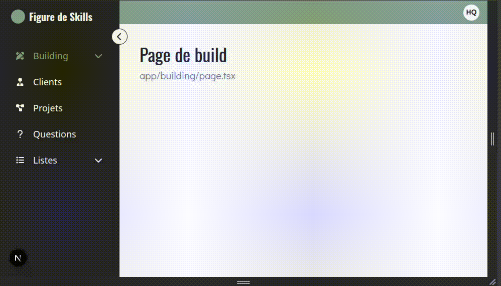

# Header
Les composants **'Header'** et **'HeaderMobile'** gèrent l'affichage du haut de page (*top navigation*).

**Header** : affichage desktop (barre fixe simple) 
**HeaderMobile** : affichage mobile (menu burger animé)

> ⚠️ le composant [**ClientLayout**](../README.md) gère l'affichage de la bonne version en fonction de la taille de l'écran.

    

## Header
Il affiche un en-tête fixé en haut lors du scoll, avec un branding/logo et quelques éléments de navigation.
Il réagit à l'état du scroll et au segment de route actif (via **useScroll** et **useSelectedLayoutSegment**).

## HeaderMobile
Il gère la navigation sur mobile avec un **menu burger animé**. 
Lorsqu'on clique sur le bouton, un cercle s'élargit pour révéler le menu.
