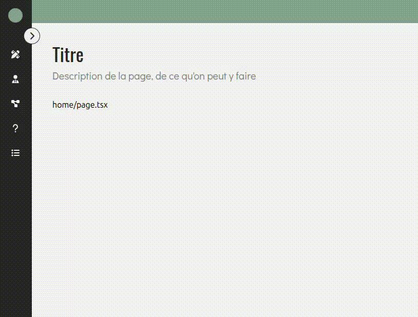

# SideNav
Le composant **'SideNav'** permet de créer une barre de navigation latérale pour les écrans desktop. Elle peut être **réduite ou étendue** (collapse), gère des **sous-menus animés** et met en surbrillance le lien actif selon l'URL courant (**usePathname**).

> ⚠️ Le composant [**ClientLayout**](../README.md) gère déjà la gestion de la SideNav dans l'affichage global.

## Structure
- **[SideNav.tsx](./SideNav.tsx)**</br>
Composant principal de la sidebar.</br>
    - Gère l'affichage général.
    - Contrôle l'ouverture/fermeture des sous-menus (**subMenu**) et met en surbrillance l'item actif en fonction du chemin actuel (**usePathname**).
    - Contient le composant interne MenuItem, qui affiche chaque item du menu, gère les sous-menus et les tooltips.

- **[types.tsx](./types.tsx)**</br>
Définitions TypeScript pour le composant.</br>
    - **SideNavItem** : type représentant un élément du menu.
    - **SideNavProps**: type pour l'état de la sidebar.

- **[constants.tsx](./constants.tsx)**</br>
Contient le tableau **SIDENAV_ITEMS** définissant tous les items et sous-items du menu.</br>
Se rendre dans ce fichier pour ajouter/modifier les items de la sidebar.

## Usage

```tsx
import { SideNav } from "@/components/layout";
import { useState } from "react";

export default function Page() {
    const [isCollapsed, setIsCollapsed] = useState(false);

    return (
        <div className="flex">
            <SideNav isCollapsed={isCollapsed} setIsCollapsed={setIsCollapsed}/>
            <main className="flex-1">
                Contenu principal
            </main>
        </div>
    )
}
```
<p align=center>
    
</p>

## API/Props
### SideNavProps
| **Prop**           | **Type**                                        | **Defaut** | **Requis** | **Description**                                                      |   |
|--------------------|-------------------------------------------------|:----------:|:----------:|----------------------------------------------------------------------|---|
| **isCollapsed**    | boolean                                         |    false   |      ✅     | Indique si la SideNav est réduite (true) ou étendue (false)          |   |
| **setIsCollapsed** | Reaact.Dispatch<React.SetSetateAction<boolean>> |      -     |      ✅     | Fonction permettant de changer l'état de collapse depuis l'extérieur |   |


### SideNavItem (*éléments du menu*)

| **Prop**         | **Type**        | **Defaut** | **Requis** | **Description**                             |
|------------------|-----------------|:----------:|:----------:|---------------------------------------------|
| **title**        | string          |      -     |      ✅     | Titre de l'item                             |
| **path**         | string          |      -     |      ✅     | Chemin de navigation associé à l'item       |
| **icon**         | React.ReactNode |      -     |      -     | Icône affichée à côté du titre              |
| **subMenu**      | boolean         |    false   |      -     | Si true, l'item contient un sous-menu       |
| **subMenuItems** | SideNavItem[]   |     []     |      -     | Tableau des sous-items                      |
| **button**       | React.ReactNode |      -     |      -     | Bouton personnalisé pour l'item (optionnel) |

## Bonnes pratiques
1. Toujours définir un **path unique** pour chaque item et sous-item.
2. Utiliser les **subMenuItems** pour structurer les liens enfants.
3. Préférer les **icônes claires** et un texte lisible pour chaque item.
4. Vérifier que l'état **isCollapsed** est correctement synchronisé avec **ClientLayout**.
5. Ne pas dépasser 1 niveau de nous-menu pour garder la navigation simple et rapide.