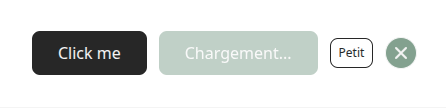

# Button
Le composant **'Button'** permet de créer des boutons interactifs, avec différents styles, tailles et états. Il est construit sur une balise native **&lt;button&gt;** ou un composant enfant (via asChild).

## Usage

```tsx
import { Button } from "@/components/ui";

<Button>Click me</Button>

<Button variant="secondary" loading>Chargement...</Button>

<Button variant="primaryBorder" size="xs">Petit</Button>

<Button className="bg-primary hover:bg-primaryhover" variant="icon" size="icon">
    <FontAwesomeIcon icon={Icons.xmark}/>
</Button>
```
<p align=center>
    
</p>

## API/Props

| **Prop**     | **Type**                                                                   | **Défaut** | **Requis** | **Description**                                                                   |
|--------------|----------------------------------------------------------------------------|:----------:|:----------:|-----------------------------------------------------------------------------------|
| **variant**  | "primary" \| "secondary" \| "primaryBorder" \| "secondaryBorder" \| "icon" |  "primary" |      -     | Variant visuel du bouton (couleur de fond, bordure, etc)                          |
| **size**     | "xs" \| "sm" \| "md" \| "icon"                                             |    "md"    |      -     | Taille du bouton                                                                  |
| **loading**  | boolean                                                                    |    false   |      -     | Affiche un état de chargement et désactive le bouton                              |
| **asChild**  | boolean                                                                    |    false   |      -     | Rend le bouton en tant que wrapper autour d'un autre élément (ex. &lt;a&gt;)      |
| **disabled** | boolean                                                                    |      -     |      -     | Désactive le bouton (désactive les interactions)                                  |
| **children** | ReactNode                                                                  |      -     |      -     | Contenu du bouton (texte, icone, etc.)                                            |
| **...props** | Toutes les props valides d'un &lt;button&gt; natif                         |      -     |      -     | Toutes les autres props sont transmises à l'élément (onClick, type, aria-*, etc.) |

### Remarques :
- Lorsque **loading** est à **true**, le bouton est considéré comme désactivé (**disabled**).
- Si **asChild={true}**, alors le composant enfant gère les props **type** ou **disabled**.
- Le ref est forwarded vers l'élément &lt;button&gt; ou le composant enfant, pour permettre le focus ou les manipulations via ref.

## Variants visuels

| **Variant**         | **Description**                                                             |
|---------------------|-----------------------------------------------------------------------------|
| **primary**         | Bouton à fond noir, conçu comme option principale.                          |
| **secondary**       | Bouton avec un style contrastant, un vert tiré de la charte visuelle.       |
| **primaryBorder**   | Bouton à fond transparent avec bordure et texte de la couleur du primary.   |
| **secondaryBorder** | Bouton à fond transparent avec bordure et texte de la couleur du secondary. |
| **icon**            | Bouton circulaire, pour les icônes.                                         |

## Bonnes pratiques

1. Utilisez le bouton avec **loading** pour indiquer des actions en cours (par exemple lors d'une soumission de formulaire).
2. Privilégiez les variantes **primary** pour les actions principales, et les variantes "secondary" ou "Border" pour les actions secondaires ou "non-invasives".
3. En contexte de lien (&lt;a&gt; ou navigation), utilisez **asChild** pour appliquer le style du bouton sans casser le comportement du lien natif.
4. Assurez-vous que le texte du bouton reste compréhensible et accessible, même en état **loading**.