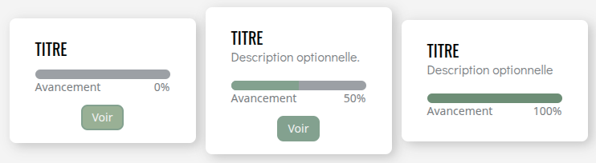

# Card
Le composant **'Card'** permet de créer des cartes d'information avec un titre, une description, une barre de progression et éventuellement un bouton d'action. Il est conçu pour être flexible et facilement personnalisable via ses props.

## Usage

```tsx
import { Card } from "@/components/ui";

<Card title="Titre" color="#99B095" progress={0} buttonLabel="Voir"/>

<Card title="Titre" description="Description optionnelle." color="#83A18F" progress={50} buttonLabel="Voir"/>

<Card title="Titre" description="Description optionnelle" color="#6D8E76" progress={100}/>

```
<p align=center>
    
</p>

## API/Props
| **Prop**      | **Type**   | **Défaut** | **Requis** | **Description**                                                                           |
|---------------|------------|:----------:|:----------:|-------------------------------------------------------------------------------------------|
| title         | string     |      -     |      ✅     | Titre de la card                                                                          |
| description   | string     |      -     |      -     | Description optionnelle                                                                   |
| progress      | number     |      0     |      -     | Valeur de la barre de progression                                                         |
| buttonLabel   | string     |      -     |      -     | Texte affiché sur le bouton. Si buttonLabel n'est pas fourni, le bouton n'est pas affiché |
| onButtonClick | () => void |      -     |      -     | Callback déclenché au clic du bouton                                                      |
| color         | string     |  "#88B081" |      -     | Couleur principale qui s'applique à la barre de progression et au bouton                  |
| className     | string     |      -     |      -     | Classes CSS supplémentaires pour personnaliser le style selon le contexte                 |

### Remarques :
- La carte affiche automatiquement la barre de progression avec le pourcentage indiqué dans **progress**.
- Si **buttonLabel** est fourni, un bouton est affiché avec le texte correspondant et l'action **onButtonClick**. Sans ça, le bouton ne s'affichera pas.


## Bonnes pratiques
1. Utilisez la prop **progress** pour indiquer l'avancement d'une tâche.
2. Privilégiez les titres et descriptions courts et clairs pour faciliter la lecture rapide.
3. Le bouton d'action doit être affiché uniquement si une action est disponible depuis la carte. Ne pas l'afficher si aucune action n'est nécessaire pour éviter la confusion.