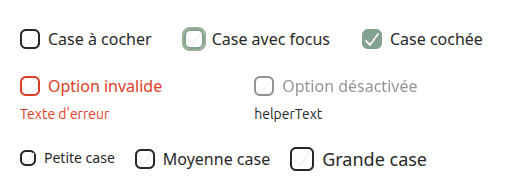

# Checkbox
Le composant **'Checkbox'** permet de créer des cases à cocher interactives avec label, message d'erreur ou helper text. Il est entièrement personnalisable via ses props et compatible avec les tailles (sm, default, lg).

## Usage

```tsx
import { Checkbox } from "@/components/ui";

<Checkbox label="Case à cocher"/>
<Checkbox label="Case cochée" checked={true}/> // case cochée par défaut

<Checkbox label="Option invalide" error="Texte d'erreur"/>
<Checkbox disabled label="Option désactivée" helperText="helperText"/>

<Checkbox size="sm" label="Petite case"/>
<Checkbox size="default" label="Moyenne case"/>
<Checkbox size="lg" label="Grande case"/>
```
<p align=center>
    
</p>

## API/Props
| **Prop**            | **Type**                                                              | **Défaut** | **Description**                                                           |
|---------------------|-----------------------------------------------------------------------|------------|---------------------------------------------------------------------------|
| **label**           | string                                                                | -          | Texte affiché à côté de la case                                           |
| **error**           | string                                                                | -          | Message d'erreur, affiché sous la case, déclenche l'état **aria-invalid** |
| **helperText**      | string                                                                | -          | Message d'aide affiché sous la case (si pas d'erreur)                     |
| **checked**         | boolean                                                               | -          | Etat coché de la case                                                     |
| **onCheckedChange** | (checked: boolean) => void                                            | -          | Callback, déclenché lors du changement de valeur de la case               |
| **size**            | "sm" \| "default" \| "lg"                                             | "default"  | Taille de la case et du label                                             |
| **disabled**        | boolean                                                               | false      | Désactive la case et la rend transparente avec le label                   |
| **className**       | string                                                                | -          | Classes CSS supplémentaires pour personnaliser le style selon le contexte |
| **...props**        | Toutes les props valides d'un &lt;input&gt; natif sauf size | -          | Toutes les autres props sont transmises à l'élément (type, value, id, etc.)         |

### Remarques :
- Les messages **error** et **helperText** sont accessibles via **aria-describedby** pour les lecteurs d'écran.
- **aria-invalid** est appliqué automatiquement si **error** est présent.
- **onCheckedChange** est appelé après la mise à jour de la valeur de la case, et transmet également l'événement original **onChange**.
- Les tailles disponibles (**sm**, **default** et **lg**) modifient à la fois la taille de la case et celle du texte du label.
- Les cases désactivées (**disabled**) désactivent aussi le label visuellement et au niveau de l'interaction.


## Bonnes pratiques
1. Toujours fournir un **label clair et descriptif** pour l'accessibilité.
2. Utiliser **error** pour indiquer des validations côté formulaire.
3. Utiliser **helperText** pour donner des indications facultatives ou complémentaires.
4. Eviter de mélaner **checked** contrôlé et uncontrolled sans **onCheckedChange**.
5. Les tailles doivent être utilisées pour harmoniser l'UI avec le reste des composants (par ex. **sm** dans un formulaire compact, **lg** pour les tableaux ou cartes).