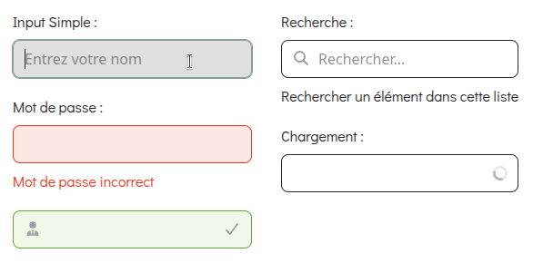

# Input
Le composant **'Input'** permet de créer des champs de saisie accessibles et personnalisables. Il prend en charge les labels, les icônes gauche/droite et les états de succès ou de chargement. Construit sur l'élément natif &lt;input&gt;, il transmet toutes ses props par défaut.

## Usage

```tsx
import { Input } from "@/components/ui";

<Input label="Input Simple" placeholder="Entrez votre nom"/>

<Input label="Mot de passe" type="password" error="Mot de passe incorrect"/>

<Input
 variant="success"
 leftIcon={<FontAwesomeIcon icon={Icons.userTie}/>}
 rightIcon={<FontAwesomeIcon icon={Icons.check}/>}
/>

<Input
 label="Recherche"
 placeholder="Rechercher..."
 helperText="Rechercher un élément dans cette liste "
 leftIcon={<FontAwesomeIcon icon={Icons.search}/>}
/>

<Input label="Chargement" loading/>
```
<p align=center>
    
</p>

## API/Props
| **Prop**       | **Type**                                                    | **Défaut** | **Requis** | **Description**                                                                       |
|----------------|-------------------------------------------------------------|:----------:|:----------:|---------------------------------------------------------------------------------------|
| **label**      | string                                                      |      -     |      -     | Texte du label, affiché au dessus du champ                                            |
| **error**      | string                                                      |      -     |      -     | Message d'erreur, déclenche l'état   aria-invalid   et le style   **variant="error"** |
| **helperText** | string                                                      |            |      -     | Texte d'aide affiché sous le champ, ignoré si error est défini                        |
| **leftIcon**   | ReactNode                                                   |      -     |      -     | Icône ou élément affiché à gauche dans l'input                                        |
| **rightIcon**  | ReactNode                                                   |      -     |      -     | Icône ou élément affiché à droite dans l'input                                        |
| **loading**    | boolean                                                     |    false   |      -     | Affiche un spinner de chargement à droite et désactive l'input                        |
| **variant**    | "error" \| "success"                                        |      -     |      -     | Variante visuelle (rouge et vert)                                                     |
| **disabled**   | boolean                                                     |    false   |      -     | Désactive l'input                                                                     |
| **className**  | string                                                      |      -     |      -     | Classes CSS supplémentaires pour personnaliser le style selon le contexte             |
| **...props**   | Toutes les props valides d'un &lt;input&gt; natif sauf size |      -     |      -     | Toutes les autres props sont transmises à l'élément (type, value, id, etc.)           |

### Remarques :
- Les labels sont associés à l'input via **htmlFor** et l'id généré automatiquement (**useId**), pour l'accessibilité.
- Si **required** est défini, un astérisque rouge est affiché à gauche du label.
- **error** et **helperText** sont liés via **aria-describedby** pour être lus par les lecteurs d'écran.
- Les icônes et le spinner de chargement ajustenet automatiquement les marques intérieurs de l'input (**padding-left / padding-right**)

## Bonnes pratiques

1. Toujours fournir un **label clair et descriptif** pour l'accessibilité.
2. Utiliser **error** pour indiquer des validations côté formulaire.
3. Utiliser **helperText** pour donner des indications facultatives ou complémentaires.
4. L'état **loading** doit indiquer une attente utilisateur, par exemple lors d'une requête de vérification en temps réel.
5. Préférer **success** uniquement pour confirmer une validation réussie.
6. Les icônes doivent **renforcer la lisibilité** (ex. icône email, recherche), pas remplacer un label.