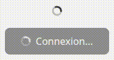

# LoadingSpinner

Le composant **'LoadingSpinner'** permet d'afficher un indicateur de chargement animé, pouvant être utilisé seul ou intégré dans d'autres composants (ex. 'Button' en état 'loading'). Il est construit avec un &lt;svg&gt;.

## Usage

```tsx
import LoadingSpinner from "@/components/ui";

<LoadingSpinner/>

<Button disabled>
    <LoadingSpinner/>
    Chargement...
</Button>

```
<p align=center>
    
</p>

## API/Props
| Prop      | Type   | Défaut | Description                                                     |
|-----------|--------|--------|-----------------------------------------------------------------|
| className | string | -      | Classes CSS supplémentaires à appliquer à l'élément &lt;svg&gt; |

### Remarques :
- Le spinner utilise **animate-spin** pour l'animation et **size-4** pour la taille par défaut.
- Les cercles utilisent **currentColor**, ce qui signifie que la couleur du spinner s'adapte automatiquement à la couleur du parent ou à toute classe Tailwind appliquée.
- L'attribut **role=status** et **aria-hidden=true** assurent une bonne accessibilité.

## Bonnes pratiques
1. Toujours fournir un **texte descriptif** si le spinner est utilisé dans un composant interactif.
3. Utiliser dans des états **loading** ou **attente utilisateur** pour indiquer que le contenu est en cours de chargement.