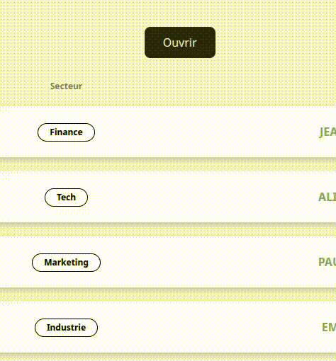

# Modal
Le composant **'Modal'** permet d'afficher une fenêtre modale superposée au contenu principal, avec gestion de l'accessibilité, du focus trap et de la fermeture par clic hors modal, touche Echap et bouton. Il est construit pour encapsuler n'importe quel contenu et peut inclure un titre, une description et des actions personnalisées.

## Usage

```tsx
import { Modal, Button } from "@/components/ui";
import { useModal } from "@/hooks";

const Page = () => {
    const modal = useModal();

    return (
        <>
            <Button onClick={modal.openModal}>Ouvrir</Button>

            <Modal
             modal={modal}
             title="Titre du modal"
             description="Une courte description ou instruction">
                <p>Contenu du modal : texte, formulaires, boutons, etc.</p>
                <Button onClick={modal.closeModal}>Annuler</Button>
        </>
    )
}
```
<p align=center>
    
</p>

## API/Props
| **Prop**        | **Type**   | **Requis** | **Description**                                     |
|-----------------|------------|:----------:|-----------------------------------------------------|
| **modal**       | ReturnType |      ✅     | Contrôle l'ouverture et la fermeture du modal       |
| **title**       | string     |      ✅     | Titre affiché en haut du modal                      |
| **description** | string     |      -     | Description ou texte d'introduction sous le titre   |
| **children**    | ReactNode  |      ✅     | Contenu du modal : texte, formulaire, boutons, etc. |

### Remarques :
- Le modal utilise un **focus trap** pour que le focus reste à l'intérieur du modal lors de la navigation au clavier (Tab / Shift+Tab).
- Le modal peut, par défaut, être fermé en cliquant sur le **fond**(backdrop), en appuyant sur **échap** ou grâce au **bouton** en haut à droite.
- Le scroll du body est bloqué pendant que le modal est ouvert pour éviter tout décalage de la page.
- Le modal est rendu via **createPortal** dans le body pour superposer correctement le contenu.
- Les boutons et le contenu sont entièrement personnalisables via les props **children**.

## Bonnes pratiques

1. Toujours fournir un **label clair et descriptif** pour l'accessibilité.
2. Limiter le contenu du modal pour éviter un scroll trop long.
3. Utiliser le modal pour des actions critiques, informations importantes ou formulaires à compléter.
