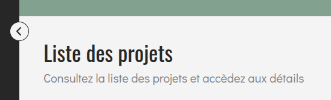

# PageHeader
Le composant **'PageHeader'** permet d'afficher un en-tête de page avec un titre et, si nécessaire, une description. Il est utile pour introduire le contenu d'une page.

## Usage
```tsx
import { PageHeader } from "@/components/ui";

<PageHeader
 title="Liste des projets"
 description="Consultez la liste des projets et accèdez aux détails"
/>
```

<p align=center>
    
</p>

## API/Props
| **Prop**        | **Type** | **Requis** | **Description**                                                           |
|-----------------|----------|:----------:|---------------------------------------------------------------------------|
| **title**       | string   |      ✅     | Titre principal affiché en &lt;h1&                                        |
| **description** | string   |      -     | Texte secondaire sous le titre, utile pour donner du contexte             |
| **className**   | string   |      -     | Classes CSS supplémentaires pour personnaliser le style selon le contexte |

## Bonnes pratiques

1. Utiliser **title** comme titre clair et concis de la page.
2. Ajouter **description** uniquement si elle apporte une valeur contextuelle.
3. Eviter les titres trop longs pour préserver la lisibilité.
4. Personnaliser l'apparence via **className** si nécessaire (ex. alignement ou marges spécifiques).