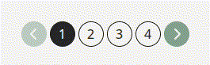

# Pagination
Le composant **'Pagination'** permet de naviguer entre plusieurs pages de contenu (listes, tableaux, etc.). Il affiche une série de boutons numérotés, ainsi que des contrôles **précédent/suivant** avec icônes.

## Usage
```tsx
import { Pagination } from "@/components/ui";

export default function Page() {
    const [page, setPage] = React.useState(1);

    return (
        <Pagination
         currentPage={page}
         totalPages={5}
         onPageChange={(newPage) => setPage(newPage)}
        />
    );
}
```

<p align=center>
    
</p>

## API/Props
| **Prop**         | **Type**               | **Requis** | **Description**                                                               |
|------------------|------------------------|:----------:|-------------------------------------------------------------------------------|
| **currentPage**  | number                 |      ✅     | Numéro de la page actuellement sélectionnée                                   |
| **totalPages**   | number                 |      ✅     | Texte secondaire sous le titre, utile pour donner du contexte                 |
| **onPageChange** | (page: number) => void |      ✅     | Fonction appelée lors d'un clic sur une page ou sur les flèches de navigation |
| **className**    | string                 |      -     | Classes CSS supplémentaires pour personnaliser le style selon le contexte     |

### Remarques
- Les boutons **précédent** et **suivant** sont désactivé si currentPage === 1 ou totalPages.
- La page active est affichée avec le style des boutons variant="primary", les autres avec variant="primaryBorder".
- Si **totalPages** est très grand, seules certaines pages proches de la page courante seront affichées.
- Des ellipses **'...'** apparaissent automatiquement pour éviter une surcharge visuelle.

## Bonnes pratiques
1. Utiliser **Pagination** uniquement lorsque le contenu est découpé en plusieurs pages (tableau, liste longue, etc).
2. Maintenir **currentPage** dans un **state** parent pour rendre la navigation réactive.