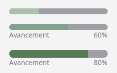

# ProgressBar
Le composant **'ProgressBar'** permet d'afficher visuellement l'avancement d'une tâche ou d'un processus.

## Usage
```tsx
import { ProgressBar } from "@/components/ui";

    <div className="w-50 space-y-5">
        <ProgressBar value={30} color="#ACBFA9"/>
        <ProgressBar value={60} color="#83A18F" showLabel/>
        <ProgressBar value={80} color="#577A56" size="lg" showLabel/>
    </div>
```
<p align=center>
    
</p>

## API/Props
| **Prop**      | **Type**             | **Défaut** | **Requis** | **Description**                                                           |
|---------------|----------------------|------------|:----------:|---------------------------------------------------------------------------|
| **value**     | number               | -          |      ✅     | Valeur actuelle de la progression                                         |
| **max**       | number               | 100        |      -     | Valeur maximale correspondant à 100%                                      |
| **size**      | "sm" \| "md" \| "lg" | "md"       |      -     | Taille de la barre                                                        |
| **color**     | string               |            |      ✅     | Couleur de la barre (nom de couleur Tailwind ou hexadécimal)              |
| **className** | string               | -          |      -     | Classes CSS supplémentaires pour personnaliser le style selon le contexte |

### Remarques :
- La largeur de la barre s'adapte automatiquement à la valeur et à la taille.
- La valeur est automatiquement constrainte entre 0 et **max**.
- Utiliser **showLabel** pour indiquer visuellement le pourcentage à l'utilisateur.
- La couleur peut-être personnalisée via Tailwing (bg-primary) ou directement en hexadécimal (#82a18e).

## Bonnes pratiques
1. Utiliser **ProgressBar** pour informer l'utilisateur de l'avancement d'une action ou d'un chargement.
2. Privilégier des couleurs contrastées avec le fond pour améliorer la lisibilité.