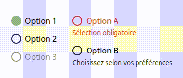

# Radio
Le composant **'Radio'** permet de créer des boutons radio interactifs. Il est entièrement personnalisable via ses props et fonctionne de manière contrôlée ou non à l'intérieur d'un **RadioGroup**.

## Usage
```tsx
import { Radio, RadioGroup } from "@/components/ui";

<RadioGroup
 name="choix"
 defaultValue="option1"
 className="space-y-3"
 onValueChange={(val) => console.log(val)}>
    <Radio label="Option 1" value="option1"/>
    <Radio label="Option 2" value="option2"/>
    <Radio label="Option 3" value="option3" disabled/>
</RadioGroup>

<RadioGroup
 name="choix2"
 className="space-y-3"
 onValueChange={(val) => console.log(val)}>
    <Radio label="Option A" value="optionA" error="Sélobligatoire"/>
    <Radio label="Option B" value="optionB" helperText="Choiselon vos préférences"/>
</RadioGroup>
```
<p align=center>
    
</p>

## API/Props
### Radio
| **Prop**       | **Type**                                          | **Défaut** | **Requis** | **Description**                                                                 |
|----------------|---------------------------------------------------|:----------:|:----------:|---------------------------------------------------------------------------------|
| **label**      | string                                            |      -     |      -     | Texte affiché à côté de la radio                                                |
| **value**      | string                                            |      -     |      ✅     | Valeur unique du radio, utilisée pour la sélection dans le RadioGroup           |
| **error**      | string                                            |      -     |      -     | Message d'erreur affiché sous le radio, déclenche **aria-invalid**              |
| **helperText** | string                                            |      -     |      -     | Texte d'aide affiché sous le radio, uniquement si **error** n'est pas défini    |
| **size**       | "sm" \| "md" \| "lg"                              |    "md"    |      -     | Taille du radio                                                                 |
| **disabled**   | boolean                                           |    false   |      -     | Désactive l'intéraction et change l'apparence visuelle (opacité)                |
| **id**         | string                                            |      -     |      -     | ID de l'élément radio (généré automatiquement si non fourni)                    |
| **className**  | string                                            |      -     |      -     | Classes CSS supplémentaires pour personnaliser le style selon le contexte       |
| **...props**   | Toutes les props valides d'un &lt;input&gt; natif |      -     |      -     | Toutes les autres props sont transmises à l'élément (ex. onFocus, onBlur, name) |

### RadioGroup
| **Prop**          | **Type**                | **Défaut** | **Requis** | **Description**                                                           |
|-------------------|-------------------------|:----------:|:----------:|---------------------------------------------------------------------------|
| **name**          | string                  |      -     |      ✅     | Nom partagé par tous les radio du groupe                                  |
| **value**         | string                  |      -     |      -     | Valeur initiale contrôlée du groupe (user ne peut pas changer)            |
| **defaultValue**  | string                  |      -     |      -     | Valeur initiale non contrôlée (user peut changer)                         |
| **onValueChange** | (value: string) => void |      -     |      -     | Callback déclenché lors du changement de valeur                           |
| **children**      | ReactNode               |      -     |      ✅     | Boutons Radio enfants                                                     |
| **className**     | string                  |      -     |      -     | Classes CSS supplémentaires pour personnaliser le style selon le contexte |

### Remarques :
- Chaque **Radio** doit être utilisé à l'intérieur d'un **RadioGroup**.
- L'état **checked** est géré automatiquement par le **RadioGroup**, contrôlé ou non.
- Les messages **error** et **helperText** sont accessibles via **aria-describedby** pour les lecteurs d'écran.
- Les radios désactivées changent visuellement et ne peuvent pas être sélectionnés.
- La taille des radios peut être petite, moyenne ou grande via la prop **size**.

## Bonnes pratiques
1. Fournir un **label clair et descriptif** pour l'accessibilité.
2. Utiliser **error** pour indiquer les validations côté formulaire.
3. Utiliser **helperText** pour fournir des informations complémentaires facultatives.
4. Utiliser un **RadioGroup** pour regrouper les radios et gérer leur état.
5. Privilégier la version contrôlée (value + onValueChange) lorsque la sélection doit être synchronisée avec un state externe.