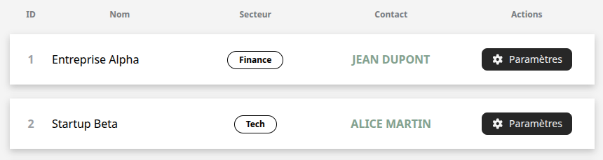

# Table
Le composant **'Table'** permet d'afficher des données tabulaires sous forme de tableau personnalisable. Il est générique et fortement typé, ce qui permet de définir la structure de chaque ligne à l'aide d'un tableau de colonnes ('columns').

## Usage
Le tableau est défini par deux éléments :
- **data**: les données brutes (tableau d'objets)
- **columns**: la configuration des colonnes, qui décrit comment chaque propriété de data doit être affichée (titre, clé, rendu)

```tsx
import { Table, Column } from "@/components/ui";

type User = {
    id: number;
    title: string;
    type: string;
    contact: string;
}

const users: User[] = [
    { id: 1, title: "Entreprise Alpha", type: "Finance", contact: "Jean Dupont" },
    { id: 2, title: "Startup Beta", type: "Tech" contact: "Alice Martin" },
];

const userColumns: Column<User>[] = [
    { key: "id", label: "ID"},
    { key: "title", label: "Nom"},
    { key: "type", label: "Secteur"},
    { key: "contact", label: "Contact"},
];

<Table data={users} columns={userColumns}>

```
<p align=center>
    
</p>

## API/Props
### **&lt;List/&gt;**
| **Prop**    | **Type**         | **Description**                                                            |
|---------|--------------|------------------------------------------------------------------------|
| **data**    | T[ ]          | Tableau de données à afficher (chaque élément doit contenir un **id**) |
| **columns** | Columns&lt;T&gt;[ ] | Définition des colonnes à afficher (clé, label, rendu personnalisé)    |

### **Column&lt;T&gt;**
| Prop      | Type                         | Description                                                       |
|-----------|------------------------------|-------------------------------------------------------------------|
| key       | string                       | Clé correspondant à une propriété de **T** (ou champ calculé)     |
| label     | string                       | Texte de l'en-tête de la colonne                                 |
| render    | (item: T) =&gt; React.ReactNode | Fonction optionnelle pour personnaliser l'affichage d'une cellule |
| className | string                       | Classes CSS supplémentaires appliquées à l'en-tête (&lt;th&gt;)   |

## Bonnes pratiques :
- Toujours définir une **colonne id** unique pour chaque ligne (clé React).
- Utiliser **render** pour personnaliser le rendu des cellules (icônes, boutons, styles).
- Limiter le nombre de colonnes affichées pour garder le tableau lisible.
- Utiliser **className** dans les colonnes pour ajuster largeur ou style spécifique.
- Réserver une colonne "Actions" pour les boutons (édition, suppression, paramètres).