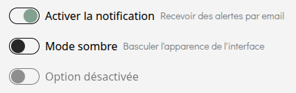

# Toggle
Le composant **'Toggle'** permet de créer un interrupteur (switch) interactif, similaire à un bouton marche/arrêt. Il peut être utilisé en version contrôlée ou non contrôlée, et peut afficher un label et un texte d'aide.

## Usage

```tsx
import { Toggle } from "@/components/ui";

// Non contrôlé
<Toggle defaultChecked={true} label="Activer la notification" helperText="Recevoir des alertes par email"/>

// Contrôlé
const [enable, setEnabled] = React.useState(false);

<Toggle
 checked={enable}
 onCheckedChange={setEnabled}
 label="Mode sombre"
 helperText="Basculer l'apparence de l'interface"
/>

// Désactivé
<Toggle disabled label="Option désactivée">

```
### Fonctionnement non contrôlé/contrôlé :
- Non contrôlé (defaultChecked): le toggle garde son état en interne. Simple à utiliser lorsqu'on a pas besoin de savoir s'il est activé ailleurs dans le code.
- Contrôlé (checked + onCheckedChange): l'état du toggle dépend d'un state externe. Utile pour réagir aux changements ou synchroniser avec d'autres composants.

<p align=center>
    
</p>

## API/Props
| **Prop**            | **Type**                                          | **Défaut** | **Requis** | **Description**                                             |
|---------------------|---------------------------------------------------|:----------:|:----------:|-------------------------------------------------------------|
| **checked**         | boolean                                           |      -     |      -     | Valeur actuelle du toggle (contrôlé)                        |
| **defaultChecked**  | boolean                                           |    false   |      -     | Valeur initiale (non contrôlé)                              |
| **onCheckedChange** | (checked: boolean) => void                        |      -     |      -     | Callback déclenché au changement (switch)                   |
| **label**           | string                                            |      -     |      -     | Texte affiché à côté du toggle, comme un titre              |
| **helperText**      | string                                            |      -     |      -     | Texte d'aide affiché à côté du label, comme une description |
| **disabled**        | boolean                                           |    false   |      -     | Désactive le toggle                                         |
| **...props**        | Toutes les props valides d'un &lt;input&gt; natif |      -     |      -     | Toutes les autres props sont transmises à l'élément         |

## Bonnes pratiques :
1. Fournir un **label clair et descriptif** pour l'accessibilité.
2. Ajouter **helperText** pour contextualiser si nécessaire.
3. Utiliser la version contrôlée si l'état doit être **synchronisé avec d'autres composants ou le state de l'application**.
4. La version non contrôlée est adaptée pour un toggle **isolé**, simple et indépendant.