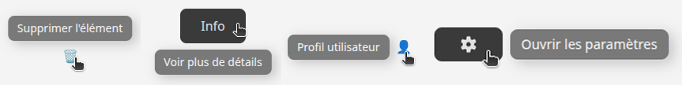

# Tooltip
Le composant **'Tooltip'** permet d'afficher une petite bulle d'information lorsqu'un utilisateur survole un élément. Il est utile pour donner plus de détails sans surcharger l'interface.

## Usage
```tsx
import { Tooltip } from "@components/ui";

// Tooltip en bas (par défaut)
<Tooltip content="Voir plus de détails">
    <Button>Info</Button>
</Tooltip>

// En haut
<Tooltip content="Supprimer l'élément" position="top">
    <span>🗑️</span>
</Tooltip>
```
### Positions disponibles
- **bottom** (par défaut) → en dessous
- **top** → au dessus de l'élément
- **left** → à gauche
- **right** → à droite
- **leftBottom** → en bas à gauche
- **rightMenu** → variante de **right** avec plus d'espace (utile pour les menus latéraux)
<p align=left>
    
</p>

## API/Props
| **Prop**      | **Type**                                              | **Défaut** | **Requis** | **Description**                                                           |
|---------------|-------------------------------------------------------|:----------:|:---------:|---------------------------------------------------------------------------|
| **content**   | string                                                |      -     |     ✅     | Texte affiché dans le tooltip                                             |
| **position**  | "top" \| "bottom" \| "leftBottom" \| "left" \| "right" \| "rightMenu" |  "bottom"  |     -     | Position du tooltip par rapport à l'élément                               |
| **children**  | React.ReactNode                                       |      -     |     ✅     | Elément(s) déclencheur(s) du tooltip                                      |
| **className** | string                                                |      -     |     -     | Classes CSS supplémentaires pour personnaliser le style selon le contexte |

## Bonnes pratiques
1. Utiliser le tooltip pour des informations **courtes et utiles**.
2. Eviter d'y mettre du contenu trop long ou interactif.
3. Choisir la position en fonction de la place disponible dans l'UI.
4. Préférer des labels explicites et utiliser tooltip comme **complément**, pas comme unique information.